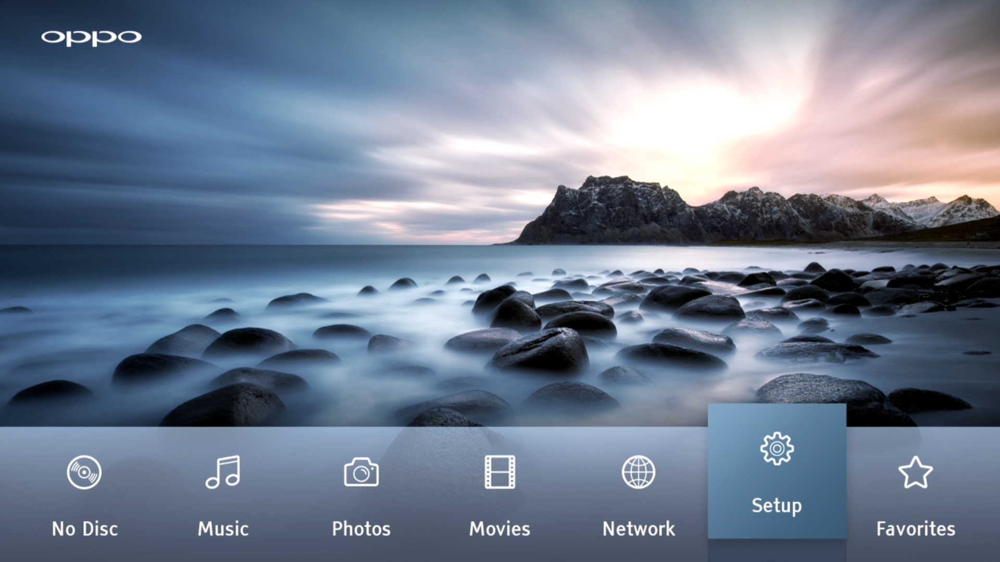
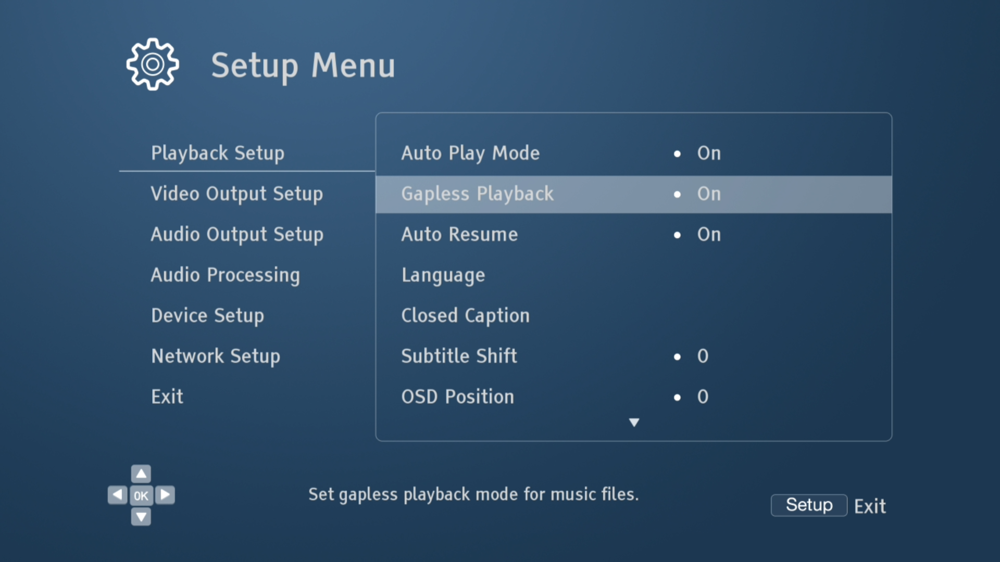
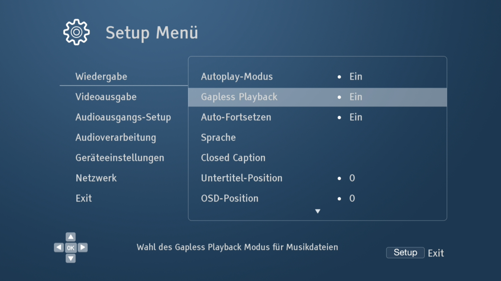
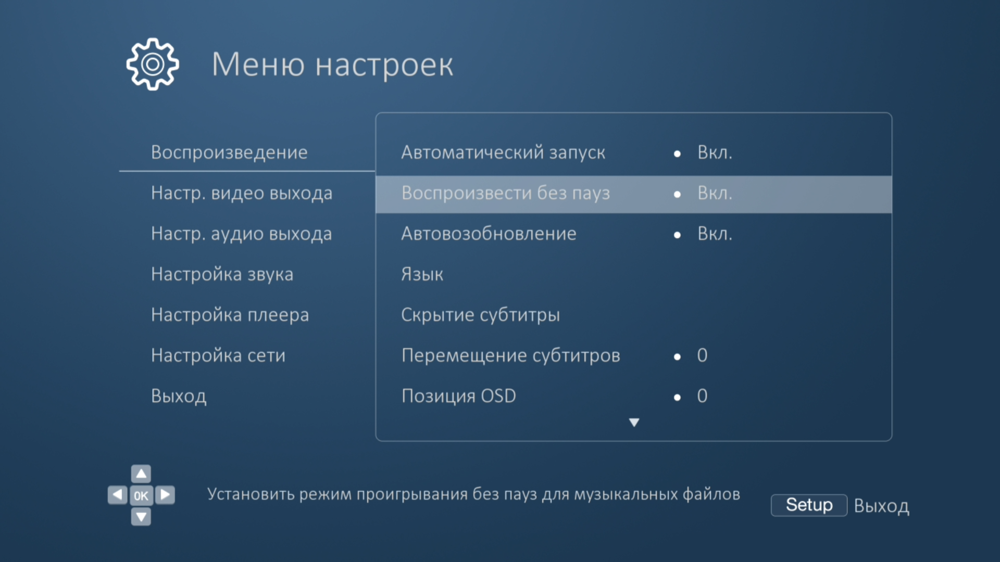

## Factory menu

The player has a hidden service page, the **Factory Page**. Its stock trigger needs keys that only Oppo's factory
remote has. With the factory menu shortcut installed, the normal remote opens it:

1. Press **Setup** and open **Playback Setup**.

|   English   | Deutch |  Russian |
| :----------:   | :------: | :---------:  |
|  |  | 

2. Move the cursor to the **second item, Gapless Playback**. Do not press Enter.

|   English   | Deutch |  Russian |
| :----------:   | :------: | :---------:  |
|  |  | 

3. Press **0 0 0 0**.

The page shows the firmware version, sub version and loader version, the DVD and Blu-ray region codes, and some
service buttons. Close it with Return.

> ⚠️ **Look, but do not press anything on this page unless you know exactly what it does.**
> - **Fmt buda** and **Fmt apda** **format** storage areas of the player.
> - The **region** fields change the player's stored DVD / Blu-ray region. This was not tested. The code that saves
>   a new region also resets other data, which was not analysed.
> - **Reset Password** was not tested either.

Opening the page runs Oppo's own code, unchanged, and that code also does two things until the next power cycle:
- **The firmware update stops checking the region/model tag** of update files. Do not run update files meant for
  another region or model while it is off (power-cycle first).
- **It starts `inetd`, a telnet server.** It can only listen when the player's network (IP) control is switched off,
  because both use port 23, and logging in needs the player's root password, which is not known. (Switching IP control
  off froze the Setup menu once during testing; a power cycle fixed it.)

How it works: the page's trigger in the player program waits, with Gapless Playback highlighted, for the factory
keys F3, F5 and F11. The shortcut replaces these three keys by the digit 0, in place (5 small edits, in RAM, at every
boot): the first 0 arms the trigger, three more open the page, any other key cancels. Nothing else changes.
Like the subtitle patch, it carries one layout per regional v65 player program (RU, EU, AU, CN, TW, JP, US/default;
in the US program the trigger code is laid out differently, so the arming branch is re-encoded for it) and picks the
one matching the running program, jailbroken or run by jb_overlay. Tested on a real player only with the RU program.
On a program that matches no layout the installer skips it and writes why in `oppo-dv-mkv-result.txt`.

**Cambridge Audio CXUHD:** its firmware (66-0614) still has Oppo's older trigger, which takes normal remote keys, so
there is nothing to install: **Setup > Playback Setup, cursor on the second item, then BLUE, 2, 4, 5, 8** (BLUE
arms it, the last four digits must be 2 4 5 8, any other key cancels). The installer recognises this code and
reports `Factory menu shortcut: not needed` with these keys. This was found in the firmware and is **not yet tried on
a real CXUHD**; the same warnings apply to the page.

